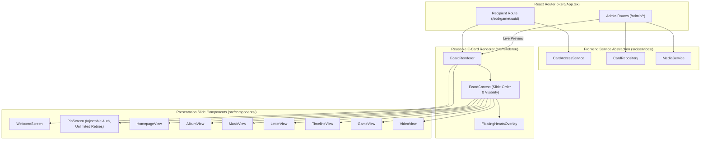

# E-Card Platform Frontend Architecture (`v1.0.0`)

**Project Root:** `/home/tts/Documents/LHA`  
**Git Branch:** `feat/ecard-platform-frontend`  
**Schema Version:** `1.0.0` (`ECARD_SCHEMA_VERSION` in [`src/types/ecard.ts`](file:///home/tts/Documents/LHA/src/types/ecard.ts))

---

## 1. Architectural Overview

The frontend has been evolved from a single-customer static recreation into a configuration-driven, multi-tenant **E-Card Platform** separated into two distinct experiences with zero tight coupling:

1. **Recipient Experience (`/ecd/game/:uuid`, `/ecd/signin/:uuid`)**:
   - Emotional, romantic, interactive experience powered by [`EcardRenderer`](file:///home/tts/Documents/LHA/src/renderer/EcardRenderer.tsx) and [`EcardContext`](file:///home/tts/Documents/LHA/src/renderer/EcardContext.tsx).
   - Preserves the exact mobile (`390×844`) appearance, animations, and touch gestures of the original By.Duni template while providing genuine responsive layouts for **Tablet (`768×1024`)** and **Desktop (`1440×900`)** without wrapping non-mobile screens inside a phone bezel.
2. **Admin Experience (`/admin`, `/admin/cards`, `/admin/cards/new`, `/admin/cards/:id/edit`, `/admin/cards/:id/preview`)**:
   - Clean, modern SaaS dashboard powered by [`AdminLayout`](file:///home/tts/Documents/LHA/src/admin/AdminLayout.tsx) and [`EditorContext`](file:///home/tts/Documents/LHA/src/admin/context/EditorContext.tsx).
   - Enables administrators to manage cards, upload and reorder media, edit photo captions and multi-paragraph love letters, configure special date milestones, customize slide visibility and ordering, configure a 4-digit PIN, and test the live card inside [`PreviewPage`](file:///home/tts/Documents/LHA/src/admin/pages/PreviewPage.tsx) using the exact same [`EcardRenderer`](file:///home/tts/Documents/LHA/src/renderer/EcardRenderer.tsx).



---

## 2. Directory & Module Structure

```text
/home/tts/Documents/LHA/
├── docs/
│   ├── FRONTEND_ARCHITECTURE.md           # This architecture document
│   ├── frontend-backend-contract.md       # Full API & TypeScript contract for OpenAI Codex
│   └── UI_UX_IMPLEMENTATION_REPORT.md     # Implementation summary, test results & Codex guide
├── src/
│   ├── types/
│   │   └── ecard.ts                       # Versioned schema (v1.0.0): EcardConfig, CardSummary, etc.
│   ├── services/
│   │   ├── CardRepository.ts              # Admin CRUD, draft, publish, archive interface
│   │   ├── MediaService.ts                # File validation & media upload interface
│   │   ├── CardAccessService.ts           # Public metadata & server PIN verification interface
│   │   ├── index.ts                       # Service factories (swap point for Codex HTTP adapters)
│   │   └── mock/
│   │       ├── MockCardRepository.ts      # In-memory card store with demo cards
│   │       ├── MockMediaService.ts        # Client-side validation + Blob URL previews
│   │       └── MockCardAccessService.ts   # Isolated dev mock PIN & content provider
│   ├── renderer/
│   │   ├── EcardContext.tsx               # Dynamic slide ordering, filtering & navigation context
│   │   ├── EcardRenderer.tsx              # Reusable configuration-driven E-Card renderer
│   │   └── FloatingHeartsOverlay.tsx      # Ambient romantic particles (respects reduced-motion)
│   ├── admin/
│   │   ├── AdminLayout.tsx                # SaaS shell with top bar & status banner
│   │   ├── AdminSidebar.tsx               # Responsive navigation sidebar
│   │   ├── context/
│   │   │   └── EditorContext.tsx          # Preserves unsaved form state across Editor <-> Preview
│   │   ├── components/
│   │   │   ├── StatCard.tsx               # Dashboard KPI metric card
│   │   │   ├── RecentCardsTable.tsx       # Responsive table/card list with quick actions
│   │   │   ├── BasicInfoSection.tsx       # Section 1: Title, couple names, love start date
│   │   │   ├── MediaUploadSection.tsx     # Section 2: Multi-image upload, reorder, audio & video
│   │   │   ├── ContentEditorSection.tsx   # Section 3: Welcome, letter paragraphs, captions, dates
│   │   │   ├── TemplateSettingsSection.tsx# Section 4: Template picker, slide visibility & ordering
│   │   │   ├── AccessSettingsSection.tsx  # Section 5: 4-digit PIN + confirmation (write-only)
│   │   │   ├── PublishingControls.tsx     # Section 6: Draft/Preview/Publish/Archive controls
│   │   │   └── ViewportSwitcher.tsx       # Mobile / Tablet / Desktop preview frame switcher
│   │   └── pages/
│   │       ├── DashboardPage.tsx          # /admin overview
│   │       ├── CardListPage.tsx           # /admin/cards search & status filter management
│   │       ├── CardEditorPage.tsx         # /admin/cards/new & /admin/cards/:id/edit
│   │       └── PreviewPage.tsx            # /admin/cards/:id/preview & /admin/preview
│   ├── components/                        # Recipient presentation & animation views
│   │   ├── WelcomeScreen.tsx
│   │   ├── PinScreen.tsx
│   │   ├── HomepageView.tsx
│   │   ├── AlbumView.tsx
│   │   ├── MusicView.tsx
│   │   ├── LetterView.tsx
│   │   ├── TimelineView.tsx
│   │   ├── GameView.tsx
│   │   ├── VideoView.tsx
│   │   ├── Sidebar.tsx
│   │   ├── FloatingNavButtons.tsx
│   │   ├── TypewriterText.tsx
│   │   ├── HeartClippedAvatar.tsx
│   │   ├── PhoneFrame.tsx
│   │   ├── SignInPage.tsx
│   │   └── ZaloBrowserModal.tsx
│   ├── context/
│   │   └── MediaContext.tsx               # Howler.js background audio & iOS Safari unlock
│   ├── hooks/
│   │   └── useTapSound.ts                 # Throttled tap sound effect hook
│   └── data/
│       └── ecardData.ts                   # Default template definitions & backward-compatible exports
└── tests/
    ├── ecard.spec.ts                      # 12 Recipient & responsive E2E tests
    ├── admin.spec.ts                      # 4 Admin Dashboard, Editor & Preview E2E tests
    └── responsive.spec.ts                 # Multi-viewport (Mobile/Tablet/Desktop) screenshot suite
```

---

## 3. Configuration-Driven Rendering & Template Extensibility

- **Dynamic Slide Pipeline (`computeActiveSlides` in [`EcardContext.tsx`](file:///home/tts/Documents/LHA/src/renderer/EcardContext.tsx))**:
  - Every `EcardConfig` specifies `slideOrder: SlideId[]` and `slideVisibility: Partial<Record<SlideId, boolean>>`.
  - `computeActiveSlides(config)` filters and orders the active slides dynamically so cards do not need to enable every page type.
  - Optional slides (`timeline`, `video`, `game`, `music`, `album`, `letter`) can be toggled on/off or reordered in the Admin Editor, and both the `SidebarDrawer`, desktop progress dots, and `FloatingNavButtons` (`goNextSlide` / `goPrevSlide`) adapt automatically.
- **Adding Future Templates**:
  - Visual templates are registered in `AVAILABLE_TEMPLATES` ([`src/data/ecardData.ts`](file:///home/tts/Documents/LHA/src/data/ecardData.ts)) with `id`, `name`, `accentColor`, `previewImageUrl`, and `supportedSlides`.
  - `EcardRenderer` inspects `config.ecardData.template_id` and `config.themeCustomization` to apply template-specific tokens or layout variants without changing the data contract or admin editor.

---

## 4. Responsive Design Strategy (Mobile, Tablet, Desktop)

| Viewport Tier | Breakpoint | Target Dimensions | Architectural Approach |
| :--- | :---: | :---: | :--- |
| **Mobile** | `< 768px` (default) | `390×844` | Preserves the exact full-bleed mobile layout, typography, spacing, touch swipe gestures, and animations of the reference By.Duni experience. |
| **Tablet** | `md:` (`768px–1023px`) | `768×1024` | Centered glassmorphic invitation cards, `md:max-w-2xl` gallery and stationery containers, horizontal 12-column music studio card, top couple badge + interactive slide progress dots, and lightbox arrow controls. |
| **Desktop** | `lg:` (`>= 1024px`) | `1440×900` | Genuine wide-screen experience (no phone bezel wrapper): 12-column split editorial homepage (`lg:max-w-5xl`), multi-row high-resolution photo gallery (`lg:max-w-4xl`), fine cream stationery letter layout (`lg:max-w-3xl`), alternating two-column milestone timeline, and ambient `FloatingHeartsOverlay` (respecting `prefers-reduced-motion`). |
