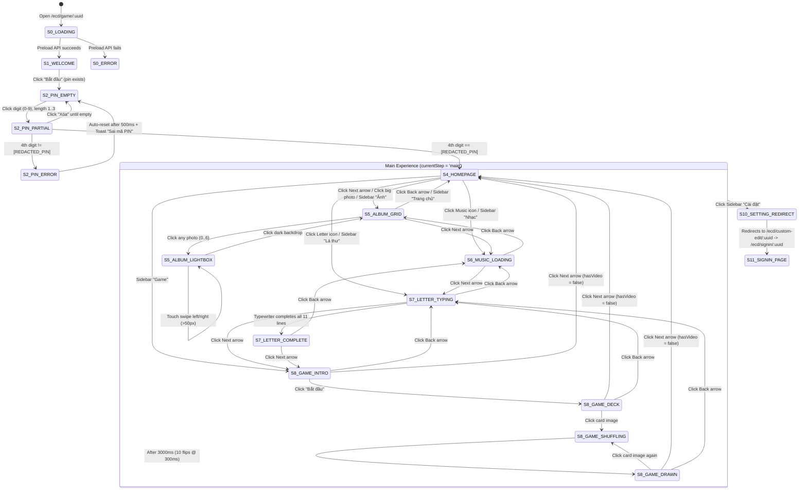

# Reference Navigation Map & State Machine

## High-Level State Machine

---

## Slide Index & Navigation Destination Table

The `main` experience manages navigation via an integer state `activeIndex` indexing into the 7-element slides array `E`:

| `activeIndex` | `id` | Sidebar Title | Visible in Sidebar? | `onBack` Destination | `onNext` Destination | Direct Shortcut From Homepage? |
| :---: | :--- | :--- | :---: | :--- | :--- | :--- |
| `0` | `homepage` | `Trang chủ` | Yes | *(No Back button)* | `1` (`album`) | N/A (Initial main screen) |
| `1` | `album` | `Ảnh` | Yes | `0` (`homepage`) | `2` (`music`) | Yes — clicking the large square `homepage_image` |
| `2` | `music` | `Nhạc` | Yes | `1` (`album`) | `3` (`letter`) | Yes — clicking `/template/icon_music.png` |
| `3` | `letter` | `Lá thư` | Yes | `2` (`music`) | `4` (`game`) | Yes — clicking `/template/icon_letter.png` (with badge `1`) |
| `4` | `game` | `Game` | Yes | `3` (`letter`) | `0` (`homepage`) when `hasVideo === false` (or `5` if `hasVideo === true`) | Via Sidebar or Next from Letter |
| `5` | `video` | `Video` | No (`hasVideo === false`) | `4` (`game`) | `0` (`homepage`) | Hidden when `hasVideo === false` |
| `6` | `setting` | `Cài đặt` | Yes | *(Redirects immediately)* | *(Redirects immediately)* | Via Sidebar `"Cài đặt"` |

---

## Important Navigation Nuances Observed

1. **Non-Linear Jump vs. Linear Prev/Next**:
   - From `homepage` (`index 0`), clicking the Letter icon (`icon_letter.png`) jumps directly to `letter` (`index 3`).
   - Once on `letter` (`index 3`), clicking the bottom-left Back button (`back.png`) executes `setActiveIndex(activeIndex - 1)`, which navigates to `music` (`index 2`), NOT back to `homepage` (`index 0`).
   - Similarly, jumping from `homepage` (`index 0`) to `music` (`index 2`) and clicking Back navigates to `album` (`index 1`).
2. **Component Remounting on Slide Change**:
   - Because each sub-page is rendered inside a `switch (currentCard.id)` statement, navigating away from a sub-page unmounts that component and resets its internal state:
     - Leaving `letter` and returning restarts the typewriter animation from paragraph 0, character 0.
     - Leaving `game` (after clicking `"Bắt đầu"` and drawing cards) and returning resets `started` (`o`) to `false`, showing the `"Hướng dẫn chơi:"` instructions screen again.
     - Leaving `music` while the YouTube song is playing unmounts the `MusicCard` component, triggering its cleanup effect (`resumeBackgroundMusic()` after 300ms), so the global `/sounds/soundtrack.mp3` resumes playing.
3. **Browser Refresh Behavior**:
   - Authentication state (`currentStep`) and `activeIndex` are stored in React component state (`useState`), not `localStorage` or URL query parameters. Refreshing the browser returns the user to `S1_WELCOME` (`"Bắt đầu"`).
